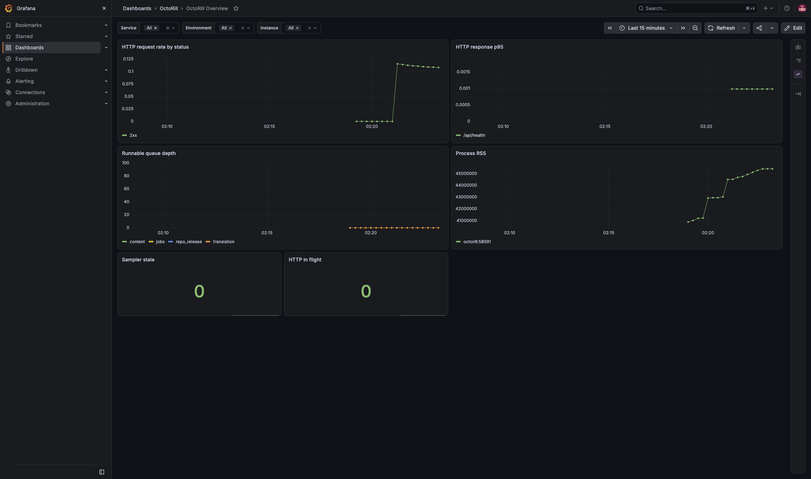
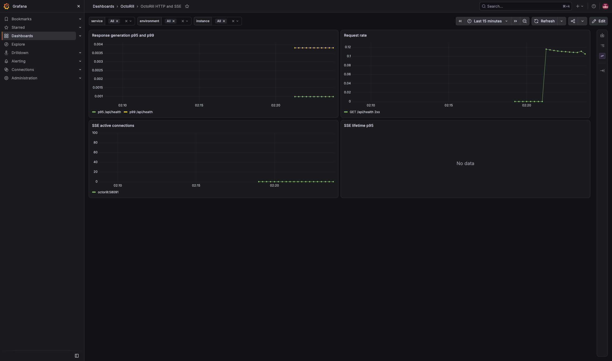
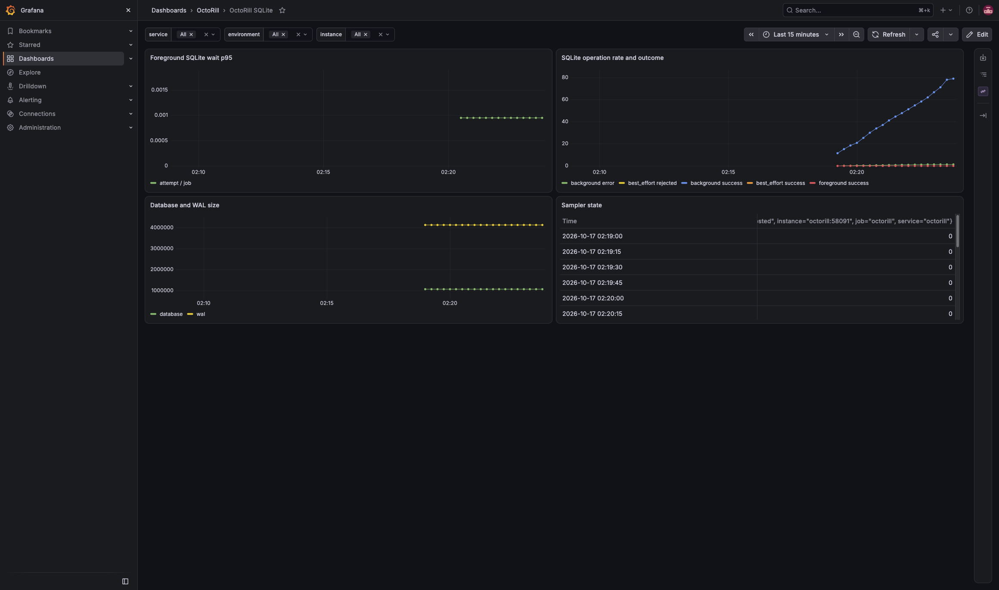
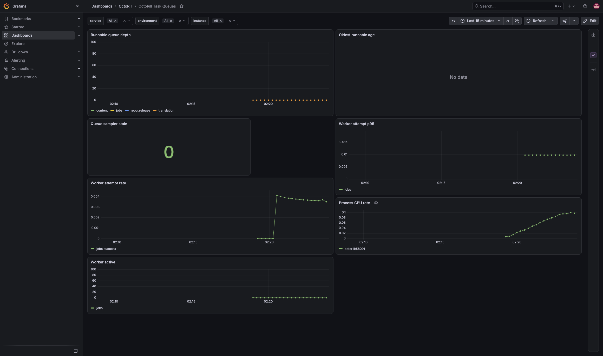
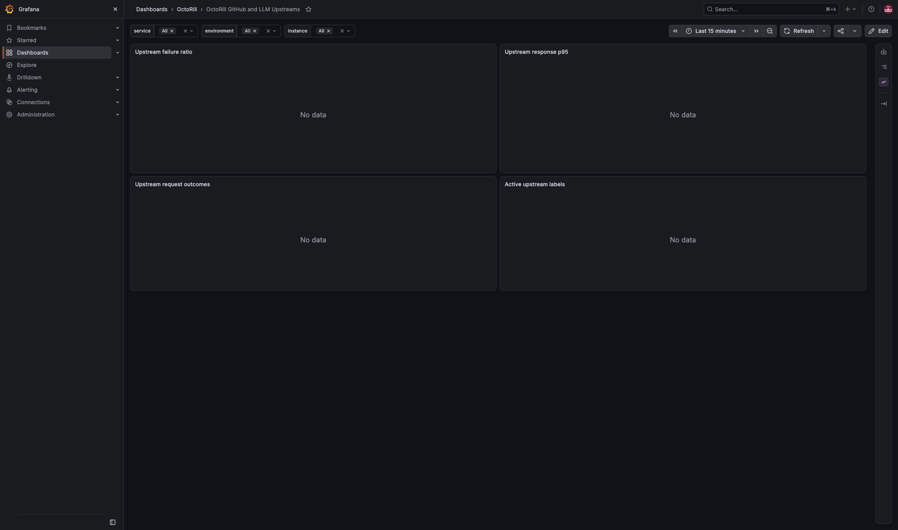

# OctoRill 核心性能监控

## 背景 / 问题陈述

维护者需要从同一套口径区分 HTTP 慢、SQLite 争用、持久化任务积压、GitHub/LLM 上游异常和进程资源压力；指标必须来自真实运行事件，并且在不启用监控时不改变业务路径。

## 目标 / 非目标

### Goals

- 提供默认关闭、有界、独立认证监听器的 Prometheus/OpenMetrics 采集能力。
- 让 Grafana 看板和只读诊断 CLI 使用同一份版本化查询目录，支持实例、服务、环境和绝对时间窗。
- 同时提供接入现有 Prometheus/Grafana 的样例和可独立运行的监控 Compose；应用不依赖监控后端启动。
- 将缺样本、采样过期、限额和后端不可用明确呈现为状态，而不是伪造零值。

### Non-goals

- 首期不实现 tracing、函数/SQL hotpath、CPU profile、日志平台或应用内性能管理页。
- 不新增服务端跨项目 Prometheus 查询限制，不改变公开治理指标 API 或管理统计合同。
- 不改变 SQLite 写入优先级、deadline、提交/取消语义，不引入历史性能数据库或多实例共享 SQLite。
- 不修改 101 线上配置、网络、凭据或实际 target；本轮只交付接入准备与隔离验证。

## Requirements

- REQ-MON-01: 应用必须以 `octorill_` 前缀注册 HTTP、SSE、SQLite、队列、GitHub、LLM、资源和采集健康指标。
- REQ-MON-02: `OCTORILL_METRICS_ENABLED` 默认必须为 `false`；关闭时不得绑定监听器或执行后台采样。
- REQ-MON-03: 启用后必须使用独立 `OCTORILL_METRICS_BIND` 监听器和 `OCTORILL_METRICS_TOKEN_FILE` Bearer token；token 缺失或为空必须拒绝启用。
- REQ-MON-04: 采集失败、编码失败和后端停机不得改变业务响应、任务结果或数据库事务语义。
- REQ-MON-05: `/metrics` 只能读取内存快照，不得在 scrape 请求中执行数据库、GitHub 或 LLM 查询。
- REQ-MON-06: 动态 label 只能使用固定白名单；未知 method、route、provider、operation、outcome、executor 必须归入固定 fallback。
- REQ-MON-07: classic histogram 必须使用固定 HTTP 桶 `0.001..300` 秒和 SSE 桶 `1..3600` 秒并包含正无穷桶。
- REQ-MON-08: 动态序列总量必须限制为 20000，OpenMetrics 输出必须限制为 4 MiB，并以固定限额指标记录拒绝。
- REQ-MON-09: HTTP 指标必须分别记录 method、规范化 route、status class、请求总量、生成耗时和 in-flight 数。
- REQ-MON-10: 普通 HTTP 响应生成、4xx/5xx、取消、body 错误和客户端丢弃必须各自完成一次生命周期计数。
- REQ-MON-11: SSE 必须记录 active 数和独立生命周期 histogram，不得混入普通 HTTP 响应分位数。
- REQ-MON-12: SQLite 必须按固定 operation、priority、outcome 记录 writer wait、连接/事务阶段、总耗时、busy、deadline、拒绝和最终结果。
- REQ-MON-13: SQLite 指标接入必须使用生命周期 guard 或等价机制，取消和 late-success 不得漏计或重复计数。
- REQ-MON-14: 后台队列必须区分逻辑工作、执行尝试和最终结果，并为 jobs、content、translation、repo_release 提供深度和最老可运行年龄。
- REQ-MON-15: 队列采样必须从持久化状态恢复，未来定时工作不得计入 runnable backlog。
- REQ-MON-16: GitHub REST、GraphQL、webhook 和 LLM 调度/请求/fallback 必须按 provider、operation、outcome 记录计数和耗时。
- REQ-MON-17: 403、429、超时和 LLM fallback 必须保持可区分；响应头等待不得标记为 TTFT。
- REQ-MON-18: 资源指标必须优先使用 Linux 真实进程 RSS、CPU、SQLite 文件和 WAL 大小；不支持的平台必须保留 unavailable 语义。
- REQ-MON-19: sampler 必须使用已有 reader pool 单连接、串行、无重叠执行，每轮含连接获取预算 500ms。
- REQ-MON-20: sampler 每 5 秒运行一次；连续 30 秒没有成功样本必须将状态标记为 stale 并保留上次成功值。
- REQ-MON-21: 采集入口默认不得公开到业务 API、不得使用浏览器 cookie、不得复用其他项目凭据；本项目不做跨项目查询隔离。
- REQ-MON-22: CLI 必须只提供 overview、http、sqlite、queues、upstream、health、compare 固定命令，不接受任意 PromQL、SQL 或 shell。
- REQ-MON-23: CLI 必须支持私网 Prometheus 和 Grafana datasource proxy，通过 token 文件、datasource UID、org 和 target labels 配置连接。
- REQ-MON-24: CLI 默认窗口为 15 分钟，单窗口最长 24 小时；默认步长 15 秒并将每条曲线限制为最多 1000 点。
- REQ-MON-25: CLI 查询并发最多 2、单次 timeout 10 秒、响应最多 4 MiB；输出必须隐藏 token 并报告样本量、新鲜度和缺测状态。
- REQ-MON-26: CLI 文本和 JSON 必须共享查询目录；JSON schema version 为 1，状态只能为 `ok`、`degraded`、`unavailable`。
- REQ-MON-27: Grafana 必须提供总览、HTTP/SSE、SQLite、任务队列、GitHub/LLM 五个固定 UID 看板，支持 service/environment/instance 筛选。
- REQ-MON-28: Compose 样例必须固定 Prometheus 3.15.0 和 Grafana 13.2.3，使用持久卷、只读配置/secret 挂载、7 天/1 GiB Prometheus 默认留存和 loopback Grafana 管理入口。
- REQ-MON-29: recording rules 和基础告警必须覆盖采集失联、HTTP 5xx/延迟、SQLite writer wait、任务积压、上游失败和 sampler stale；样例默认不加载，启用与通知由部署侧负责。
- REQ-MON-30: 文档必须说明共享栈接入、独立 Compose、凭据分工、缺测/背压排查、101 适配事实和未授权线上变更边界。

## Verification

- VER-MON-CONTRACT: 覆盖 REQ-MON-01～REQ-MON-08；检查指标目录、label 白名单、固定桶、序列/输出预算和 fallback。
- VER-MON-HTTP-SSE: 覆盖 REQ-MON-09～REQ-MON-11；检查 HTTP body/SSE 成功、错误、取消、丢弃和活跃量归零。
- VER-MON-SQLITE: 覆盖 REQ-MON-12、REQ-MON-13；检查 writer/reader 饱和、busy、deadline、取消、late-success 与连接复用。
- VER-MON-WORKERS: 覆盖 REQ-MON-14～REQ-MON-17；检查持久化队列恢复、未来工作、重试/取消、403/429/timeout/fallback。
- VER-MON-SAMPLER: 覆盖 REQ-MON-18～REQ-MON-20；检查串行采样、deadline、stale、上次成功值和 unavailable。
- VER-MON-ACCESS: 覆盖 REQ-MON-21～REQ-MON-23；在隔离环境检查默认关闭、token、Prometheus/Grafana 两种只读入口和凭据不泄露。
- VER-MON-CLI: 覆盖 REQ-MON-22、REQ-MON-24～REQ-MON-26；用 fixture 检查固定命令、时间窗、点数、状态和 JSON/text 一致。
- VER-MON-STACK: 覆盖 REQ-MON-27～REQ-MON-30；检查五个看板、Compose provisioning、规则默认暂停和文档接入步骤。
- VER-MON-PERF: 覆盖所有运行时指标需求；在隔离 VM 用同一候选 SHA 做三对关闭/开启负载，吞吐下降不超过 5%、CPU 每完成操作增加不超过 10%、p95/p99/RSS/scrape 满足计划阈值。

## Interfaces & Contracts

| Interface | Kind | Scope | Contract | Owner | Consumers |
| --- | --- | --- | --- | --- | --- |
| `/metrics` | OpenMetrics HTTP | private | 独立监听、Bearer token、内存快照、4 MiB 上限 | backend | Prometheus |
| `OCTORILL_METRICS_*` | environment variables | deployment | 默认关闭；bind、token file、1-60 秒采样间隔 | backend ops | self-hosted deployment |
| `ops/observability/query-catalog.json` | versioned data | repository | schema version 1；CLI 与 Grafana 只使用固定查询口径 | maintainers | diagnostics/dashboard |
| `scripts/octorill-observe` | CLI | operator | 固定命令、只读查询、4 MiB/10 秒/2 并发上限 | maintainers | operators/agents |
| `ops/observability/docker-compose.yml` | deployment sample | self-hosted | Prometheus 3.15.0 + Grafana 13.2.3，持久卷和 loopback 管理入口 | deployment ops | self-hosted |

## Defaults

- `OCTORILL_METRICS_ENABLED=false`、`OCTORILL_METRICS_BIND=127.0.0.1:58091`、`OCTORILL_METRICS_SAMPLE_INTERVAL_SECONDS=5`；启用时必须设置 `OCTORILL_METRICS_TOKEN_FILE`。
- Prometheus 默认 scrape 15 秒、timeout 5 秒；sampler 每 5 秒运行，单轮 500ms，30 秒无成功即 stale。
- CLI 默认窗口 15 分钟、最长 24 小时、步长至少 15 秒、每条曲线最多 1000 点、查询并发 2、timeout 10 秒、响应 4 MiB；compare 默认使用上一等长窗口，也支持显式基线窗口。
- 101 适配仅核对运行版本、网络、认证、datasource、provisioning 和机器 GET 路径；target 启用和线上连通性需另行授权。

## Related ADRs

- [ADR 0020：性能观测边界](../../adr/0020-performance-observability-boundary.md)

## Acceptance Criteria

- Given metrics 未启用，When 应用启动，Then 无 metrics listener、无 sampler，业务启动和请求合同不变。
- Given token 正确，When Prometheus 读取 `/metrics`，Then 获得固定 prefix 的内存快照；错误 token 得到 401，且请求不触发业务 SQL 或上游调用。
- Given writer/reader 竞争、任务积压或上游失败，When 查询 Grafana 或 CLI，Then 可区分对应瓶颈、样本量、窗口和 stale/degraded/unavailable 状态。
- Given sampler 或监控后端停止，When 业务继续处理请求，Then 业务结果继续可用，恢复后采样继续更新而不把缺测显示为零。
- Given Compose 全新启动，When provisioning 完成，Then 五个固定 UID 看板和共享查询目录可用，告警样例默认未启用。

## Visual Evidence

- Source: real Grafana 13.2.3 runtime in the session-owned Agent VM; `target_program=Grafana`; capture scope is limited to the five OctoRill dashboard viewports.
- Visual comparison: current-only because this topic had no readable historical screenshot baseline; the owner confirmed the displayed candidate screenshots before they were persisted here.
- The captured runtime shows real HTTP, SQLite, queue, resource, sampler, and no-sample upstream states; the temporary VM port binding used for capture is not part of the repository Compose contract.

