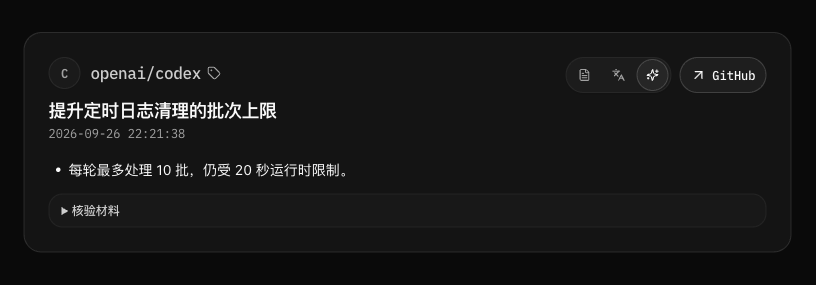
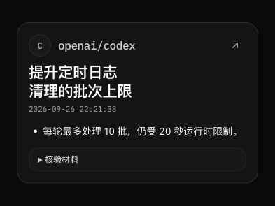
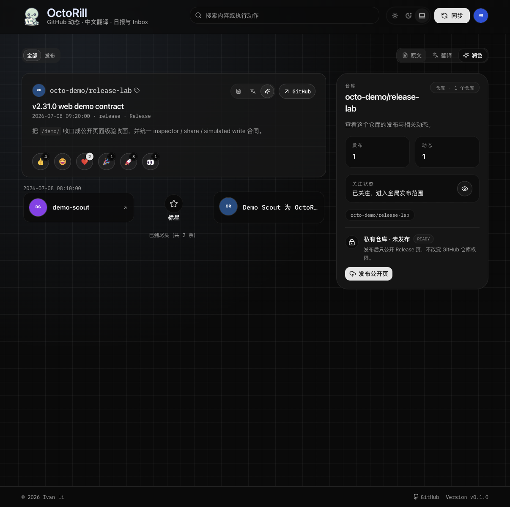

# Release 阅读内容与变更依据

## Context and Scope

OctoRill 为读者整理 GitHub 动态，润色与日报承担直接说明变化的职责。原文中的贡献归属、发布模板与机器元数据不应因格式完整而自动进入阅读正文；生成过程读取的 PR 与代码差异也不应自动变成面向读者的取证报告。

本主题统一 Release 信息流、详情与日报中的内容选择、变更依据、折叠边界和结果消费语义。阅读模式控件由 [release-feed-smart-tabs](../release-feed-smart-tabs/SPEC.md) 维护，日报时间窗口与快照由 [release-daily-brief-v2](../release-daily-brief-v2/SPEC.md) 维护，全局工作的身份、授权与写入边界由 [global-translation-and-polish](../global-translation-and-polish/SPEC.md) 维护。

本主题不更名既有能力，不改写原文或翻译，不增加来源面板、人工编辑后台或通用 GitHub 客户端能力，也不授权生产数据刷新。

## Terms and Interfaces

- 领域用语以根目录 [GLOSSARY.md](../../../GLOSSARY.md) 为准，特别区分润色、变更要点、变更依据、核验材料与无有效变更信息。
- 原文是发布者提供的内容；翻译忠实表达原文；润色基于事实组织便于理解的变化与必要说明。
- Feed、详情与日报是同一 Release 事实的不同阅读视图，不各自创造变化事实。
- 本主题规定内容与消费契约，不在文档阶段锁定新增 API 字段、数据库列或模型响应的具体编码。

## Requirements

### REQ-RC-READING

- 润色必须直接说明有依据的实际变化、影响、使用条件与必要操作；不得把发布发生本身、版本名称、Alpha 标签或仓库名称扩写成变更要点。
- 只有标题已承载全部有效信息时，正文可以省略，不得为满足非空输出而重复标题。
- 不得从性能类标签推断收益，也不得把制品形态描述包装成新增功能。

### REQ-RC-EDITING

- 正文必须删除无阅读价值的作者归属、PR 流水账、模板标题与版本复述；删除归属尾句时必须保持句子完整。
- 卡头已明确单一版本时，正文不重复版本号。同一 Release 涉及多个产品或组件版本，或正文需要说明升级范围时，必须保留必要的版本区分。
- 不得自动添加“相关链接”“来源”“发布原文”或“实现依据”区；原文切换、Release 主入口与现有 GitHub 动作继续提供完整上下文。
- 安全公告、迁移指南等理解或操作所必需的链接可以保留，并应直接可见。确需引用 PR 时，链接文字必须明确为 `PR#编号`，不得用含糊标签掩盖目标类型。

### REQ-RC-VISIBILITY

- 高价值内容必须直接展示，包括实际变化、必要限制、兼容性影响、风险与操作要求，不得用折叠降低其可见性。
- 只有有实际核验价值、但通常不需要人工逐字阅读的机器材料可以折叠，例如完整构建指纹或制品清单；日报省略这类机器材料。
- 无价值内容应删除，不得搬入折叠区；不得仅凭“测试”“CI”“内部维护”等类别标签隐藏可读变化。

### REQ-RC-EVIDENCE

- 发布标题与正文能够说明变化时，生成过程应优先使用原文事实；只有占位、链接、版本模板或缺乏实际变化说明时，必须尝试获取并分析可用代码差异。
- 比较基线必须适合该发布系列、通道与提交关系，不得仅因发布时间相邻就跨发布系列比较。生成过程必须明确比较范围并处理提交分叉语义。
- 提交标题、有效文件变化与必要 patch 应共同支撑要点；二进制、生成文件与锁文件噪声不得单独被包装成用户收益。
- 依据不足时必须停止推断。无法取得所需差异与已核查但无有效变更信息必须分别表达。

### REQ-RC-CONSUMPTION

- 全局与遗留生成路径必须遵循相同的 Release 内容规则；不得以通用翻译式 prompt 替代 Release 变化判断，也不得为了获取旧能力绕过全局调度、授权与冻结来源边界。
- Feed、详情与日报必须消费一致的变更事实及内容结论。结构化事实应独立于各阅读面的 Markdown 排版，日报不得仅凭段落是否带列表前缀判断摘要是否存在。
- 业务校验必须区分有效变化与无有效变更信息；字段非空或 provider 调用成功不能独立构成有价值摘要的成功条件。

### REQ-RC-STATES

- 必须区分尚未完成、处理失败、无有效变更信息与结果契约不兼容；不得互相推断或合并成“暂未生成”。
- 处理状态必须与变更正文分开表达，不得生成“暂未生成变更摘要，请打开 Release 详情查看原文与润色”等子要点。
- 已有有效内容时应继续提供阅读；不可解析的已有结果必须保留其真实处理事实，不得误报为从未生成。

### REQ-RC-BRIEF

- 日报必须按项目组织实际变化。同一项目一天多个版本可以合并叙述，但必须保持每项变化所属版本清楚，不得混淆发布范围或重复表述相同变化。
- 原文与可用代码差异均已核查但仍无有效变更信息时，日报必须保留仓库与版本的最简发布记录，不生成正文子要点，也不将该发布从日报移除。没有正文的紧凑条目不属于隐藏已有内容的折叠区。
- 日报必须保留进入 Release 详情的现有主入口，不机械为每项变化再附带 PR、compare 或发布原文入口；确有阅读或操作意义的必要引用仍遵循正文链接规则。
- 测试夹具拆分等有明确事实的变化可以直接用简洁语句说明，不附加未经证实的性能或稳定性收益。

## Verification

### VER-RC-READING

- covers: REQ-RC-READING, REQ-RC-EDITING
- 以版本模板、作者 / PR 尾句、重复标题与仅含交付形态的 Release 检查输出：没有伪变化、版本复述、句子残骸或额外来源区，必要操作链接与明确标注的必要 PR 引用可正常阅读。

### VER-RC-VISIBILITY

- covers: REQ-RC-VISIBILITY
- 以接入限制、迁移要求、测试重构、完整构建指纹与无价值模板混合的材料检查阅读结果：可读变化和高价值说明直接展示，只有有价值的机器材料可折叠，无价值内容不出现在任何折叠区，日报不输出机器材料。

### VER-RC-EVIDENCE

- covers: REQ-RC-EVIDENCE, REQ-RC-CONSUMPTION
- 对只有 `Release + 版本号` 的输入，通过 global 与 legacy 入口检查相同内容规则；以发布系列交错、提交分叉、有效模型目录 patch、只有噪声的 diff 和 compare 拉取失败分别验证基线、事实提取、无信息结论与失败状态。

### VER-RC-CONSUMPTION

- covers: REQ-RC-CONSUMPTION, REQ-RC-STATES
- 将相同变更事实分别交给 Feed、详情与日报，检查三者语义一致；对已有 ready 段落、排队、失败、无信息与契约不兼容输入检查状态区分，不因缺少 Markdown 列表前缀产生“暂未生成”子要点。

### VER-RC-BRIEF

- covers: REQ-RC-BRIEF, REQ-RC-EDITING
- 以同一项目一天多版本检查归并结果：每项变化的版本归属明确、主入口保留、测试变化直接可读，没有“相关链接”或重复发布原文入口；无有效变更信息的版本仍有最简发布记录，但没有正文子要点。

## Visual Evidence

- source_type: `storybook_canvas`
  target_program: `mock-only`
  capture_scope: `element`
  requested_viewport: `feedItemDesktop923`
  viewport_strategy: `storybook-viewport`
  margin_policy: `require_margin`
  evidence_surface: `component`
  surface_selector: `[data-visual-evidence-surface]`
  target_selector: `[data-visual-evidence-target]`
  sensitive_exclusion: `N/A`
  submission_gate: `owner-approved`
  story_id_or_title: `Feed/FeedItemCard/Release Reading Shows Changes And Folds Machine Material`
  state: `changes visible, machine materials collapsed`
  evidence_note: `桌面卡片直接展示 10 批与 20 秒限制；核验材料保持折叠。`
  image: 

- source_type: `storybook_canvas`
  target_program: `mock-only`
  capture_scope: `element`
  requested_viewport: `feedItemMobile393`
  viewport_strategy: `storybook-viewport`
  margin_policy: `require_margin`
  evidence_surface: `component`
  surface_selector: `[data-visual-evidence-surface]`
  target_selector: `[data-visual-evidence-target]`
  sensitive_exclusion: `N/A`
  submission_gate: `owner-approved`
  story_id_or_title: `Feed/FeedItemCard/Release Reading Mobile`
  state: `changes visible, machine materials collapsed`
  evidence_note: `移动卡片保持变化直显、折叠材料和标题换行，无横向溢出。`
  image: 

- source_type: `ui_demo`
  target_program: `mock-only`
  capture_scope: `browser-viewport`
  requested_viewport: `1206x1200`
  viewport_strategy: `devtools-emulate`
  margin_policy: `trim_only`
  evidence_surface: `page`
  submission_gate: `owner-approved`
  story_id_or_title: `ui_demo: ./demo/focus/repo/octo-demo/release-lab?demo=dashboard-repo-publish Feed Recovery / Original Release Visible`
  state: `member dashboard with original Release selected`
  evidence_note: `本地 mock Dashboard 展示可读的原始 Release 正文；精确错误码回退和通用 5xx 保持错误由 dashboard-brief-detail E2E 验证。`
  image: 

## Related ADRs

- [ADR 0022: Release 阅读的私有差异依据边界](../../adr/0022-release-reading-private-evidence-boundary.md)

## References

- [实现状态与已知缺口](./IMPLEMENTATION.md)
- [主题边界与历史](./HISTORY.md)
- [内部产品参考](../../product.md)
